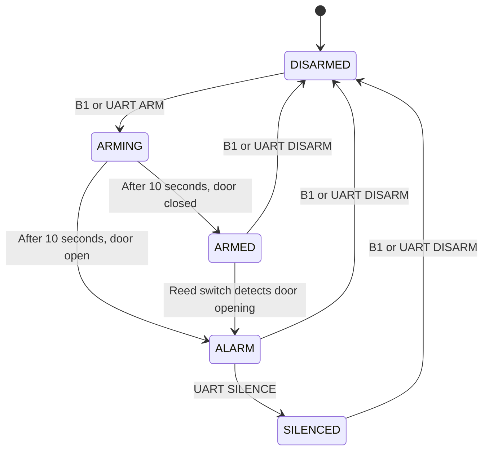

# Project Description

A small IoT alarm for a door, drawer, or box lid. An STM32 Nucleo-F411RE reads the sensors and runs the alarm logic. A NodeMCU connects it to the NETPIE cloud, so you can watch and control it from a phone.

## Fixed

| Item | Choice |
|---|---|
| Controller | STM32 Nucleo-F411RE (C, CubeIDE + HAL) |
| WiFi bridge | NodeMCU (Arduino) |
| Sensor 1 | Reed switch KY-021 (door open/closed) |
| Sensor 2 | Ultrasonic HC-SR04 (distance, reported to the phone) |
| Actuator | Active buzzer KY-012 (siren) |
| Cloud | NETPIE (MQTT + Freeboard dashboard) |
| STM32 ↔ NodeMCU | UART, text lines |

## How it works

Five states, all kept on the STM32 (the alarm still works if WiFi drops):



- **Arm:** button or phone. 10 s to leave.
- **Alarm:** The reed switch triggers ALARM if the door is open when the 10-second countdown ends or if it opens while armed. Closing the door leaves the alarm active and the buzzer beeping.
- **Distance:** measured and sent to the phone in every state. It never triggers the alarm.
- **Silence:** phone only. ALARM → SILENCED: buzzer off, alarm still on record, door still counted as breached.
- **Disarm:** button or phone, from ARMED, ALARM or SILENCED. Disarm from the phone before opening the door to avoid a false alarm.

## Interfaces (2 total)

| # | Interface | Shows | Controls |
|---|---|---|---|
| 1 | **On the device:** button B1, LED LD2, buzzer | State via LED pattern + beeps | Arm/disarm with B1 |
| 2 | **NETPIE Freeboard dashboard** (phone browser) | State, door, distance | Arm, Disarm, Silence buttons |

## Data flow

```
Reed + Ultrasonic → STM32 → UART → NodeMCU → WiFi → NETPIE → Freeboard (phone)
                      ↓                                  ↑
                   Buzzer, LD2                    Arm/Disarm/Silence
```

### UART protocol (STM32 ↔ NodeMCU)

115200 baud, 8N1. One message per line, ending with `\n`. First field is the message type; fields are comma-separated. Each side ignores lines it doesn't understand.

| Dir | Type | Format | Example | When sent |
|---|---|---|---|---|
| STM32 → NodeMCU | **S** status | `S,<state>,<door>,<dist>` | `S,ARMED,0,132` | Every 2 s, and immediately when anything changes |
| NodeMCU → STM32 | **C** command | `C,<command>` | `C,DISARM` | When the dashboard sends one |

| Field | Values |
|---|---|
| `state` | `DISARMED`, `ARMING`, `ARMED`, `ALARM`, `SILENCED` |
| `door` | `0` closed, `1` open |
| `dist` | Distance in cm; `-1` if no valid reading |
| `command` | `ARM` (start 10 s countdown), `DISARM`, `SILENCE` (only valid in ALARM) |

A command that doesn't fit the current state (for example `ARM` while already ARMED) is ignored. The next `S` line shows the result, so there is no separate acknowledgement. Button presses need no message: the STM32 changes state and reports it in `S`.

### NETPIE (NodeMCU ↔ cloud)

| Direction | Topic | Content | Created from |
|---|---|---|---|
| Publish | `@shadow/data/update` | `{"data":{"state":"ARMED","door":0,"dist":132}}` | `S` lines |
| Subscribe | `@msg/cmd` | `ARM`, `DISARM`, or `SILENCE` | Forwarded to STM32 as `C,<command>` |

## Requirements check

| Requirement | Met by |
|---|---|
| STM32 ↔ NodeMCU communication and processing | UART protocol; STM32 filters sensors and runs the state machine |
| 3 different sensor/actuator types | Magnetic, distance, sound |
| Internet and cloud | NodeMCU → NETPIE over MQTT |
| Team of 3–4 with roles | Embedded / System architect + ESP / UI + management |
| Public repo | Created in week 1 |

## Roles

| Member | Role |
|---|---|
| A | STM32 drivers, filtering, state machine |
| B | Wiring, protocol, NodeMCU firmware, NETPIE setup, integration |
| C | Dashboard, weekly reports, Git repo, demo script, final report |

